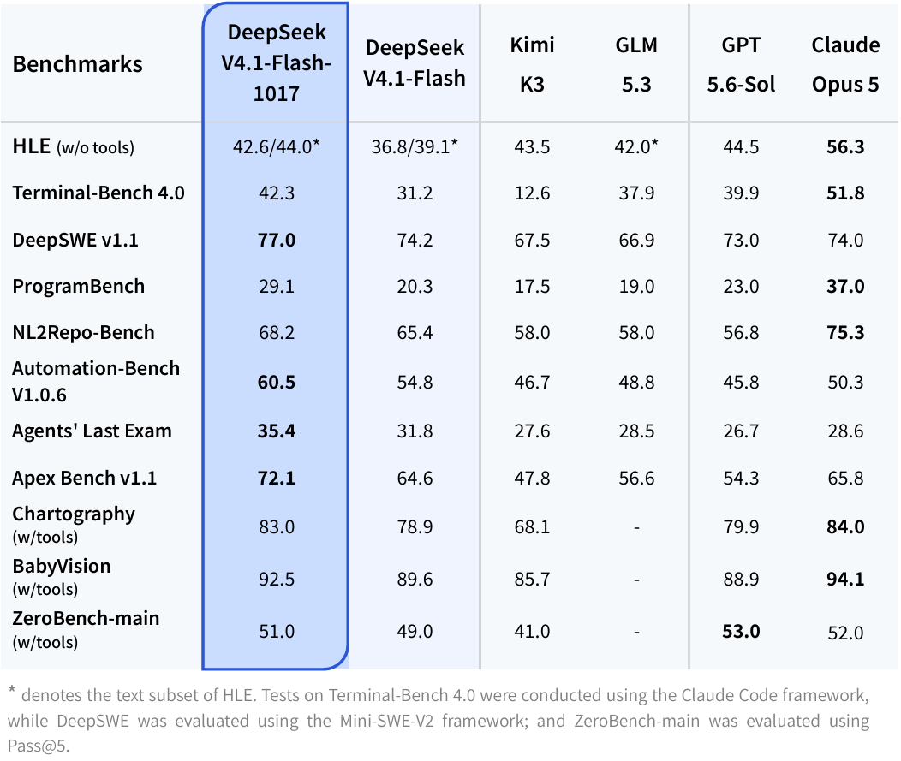

# LLM Benchmark Self-Test Guide

DeepSeek-V4.1-Flash-1017 模型卡上 **11 个基准**的自测资料包：每个基准的官方来源、数据可得性、判分协议、复现命令、成本估算与踩坑记录。

> 目标：帮你「自己跑这些基准测模型」，而不是只看厂商自报分数。



## 内容

| 路径 | 说明 |
| :-- | :-- |
| [`AGENTS.md`](AGENTS.md) | 仓库协作说明：数据流、重建命令、事实与证据规则、完成标准（给 AI Agent 与维护者） |
| [`report/benchmark-guide.md`](report/benchmark-guide.md) | **主报告**：11 项逐条详解、横向对比、口径警告、三档自测路线、成本与避坑 |
| [`report/api-only-5bench-plan.md`](report/api-only-5bench-plan.md) | **API-only 执行方案**：5 个基准的接入矩阵、配置模板、三阶段预算与公平性规则 |
| [`report/offline-airgap-plan.md`](report/offline-airgap-plan.md) | **断网环境方案**：把镜像/数据/harness 打成离线包带到公司跑内网模型 |
| [`report/first-batch-bundle.md`](report/first-batch-bundle.md) | **第一批打包实录**：镜像清单、5.06GB 整包、离线验证结果与经验 |
| [`report/second-batch-bundle.md`](report/second-batch-bundle.md) | **第二批打包实录**：TB4 v4.0.0 36 题（15 + 扩 21）+ NL2Repo 10 题，离线 agent 安装与 ghcr 镜像源迁移 |
| [`report/company-day1-checklist.md`](report/company-day1-checklist.md) | **到公司后 30 分钟操作清单（第一批）**：加载→验通→首题判分→启动长任务 |
| [`report/company-day1-checklist-batch2.md`](report/company-day1-checklist-batch2.md) | **到公司后第二批操作清单**：TB4 mcp 补丁自检 / oracle / agent 冒烟 / NL2Repo 端到端 / 正式跑与收尾 |
| [`report/company-32c64g-concurrency.md`](report/company-32c64g-concurrency.md) | **公司 32C/64G 并发预设**：容量/工期/降级规则；入口 `offline/config/32c64g.env` + `./offline/run_batch2_32c64g.sh tb4\|oracle\|nl2repo` |
| [`report/centos7-docker-offline.md`](report/centos7-docker-offline.md) | **CentOS 7 离线 Docker 安装包**：Docker CE 20.10.24 + 23 个依赖 RPM + 安装/自检脚本（`docker-el7/`），含旧 daemon API 兼容实测 |
| [`report/opencompass-offline-bundle.md`](report/opencompass-offline-bundle.md) | **OpenCompass 离线模型对比包**：15 个数据集族（含 LiveCodeBench、HLE LLM-Judge）、5 档套件、约 808 MB 离线目录，Docker 20.10.24 实测（辅助工具，不属于 11 基准） |
| [`report/results/`](report/results/) | **实测证据归档**：两批基准的原始结果、轨迹与冒烟日志（第二批含 TB4 oracle/agent 现场与 NL2Repo 端到端） |
| [`report/benchmarks.xlsx`](report/benchmarks.xlsx) | 对比表：总览（11 行×24 列）、Harness 工具链、三档自测方案、数据来源 |
| [`report/runbook.md`](report/runbook.md) | 每个基准的复现命令清单（可直接复制） |
| [`report/all_benchmarks.json`](report/all_benchmarks.json) | 结构化机读数据（每基准 40+ 字段） |
| [`research/`](research/) | 原始调研：4 份 JSON + 中文笔记（逐条来源、成本假设、TODO） |
| [`scripts/`](scripts/) | 合并校验、runbook 生成、xlsx 生成脚本 |
| [`configs/`](configs/) | API 接入配置模板（mini-swe 自定义端点、NL2Repo config、LiteLLM registry） |
| [`offline/`](offline/) | 离线包构建/加载脚本、runner 镜像与 compose 模板（断网环境用） |
| [`assets/`](assets/) | 官方发布页截图（基准表、DeepSWE 成本-性能图） |
| [`sources/`](sources/) | DeepSeek 官方模型卡原文存档 |

## 11 个基准

通用推理 **HLE**；Agent **Terminal-Bench 4.0 / Automation-Bench v1.0.6 / Agents' Last Exam / Apex Bench v1.1**；代码 **DeepSWE v1.1 / ProgramBench / NL2Repo-Bench**；视觉 **Chartography / BabyVision / ZeroBench-main**。

## 三分钟结论

1. **10/11 可自测**；Apex Bench v1.1 只有模型卡一行数字，查无数据/runner。
2. **模型卡数字不能直接对齐**：视觉三项是 `w/tools`（Claude Code harness，512k 上下文）口径，官方协议是 no-tools；HLE、Automation-Bench、ALE 官方榜用**私有 held-out 集**；Terminal-Bench 4.0 被 Epoch 复核出 30/66 题评分缺陷。
3. **最便宜先跑**：ZeroBench-main（100 题×5 采样，约 $0.1–1.7，无需 judge）→ BabyVision（388 题，MIT 数据）→ HLE 纯文本（50 题约 $2–8）。
4. **最贵最后跑**：Agents' Last Exam（真机 VM/GUI）、ProgramBench（linux/amd64、$36/题）、Terminal-Bench 4.0（整轮 $634–7,334）。
5. **框架**：EvalScope 覆盖 6/11 最省事；Harbor=TB4、Pier=DeepSWE；Inspect AI 跑 HLE/ZeroBench（Chartography 官方就是 Inspect）；lm-evaluation-harness 与 simple-evals 不支持这些基准。
6. **本机跑不了 DeepSeek-V4.1-Flash-1017 本体**（~763B 参数，官方 MP=8 推理）——真分数走 API。

## 快速开始

```bash
# 档 0：0 元验证管道（需要 Docker；Python 3.12 用 uv 隔离）
uv tool install harbor
harbor run -d terminal-bench/terminal-bench@4.0.0 -a oracle -k 1 --n-concurrent 1
pip install evalscope
evalscope eval --model <model> --api-url <openai-compatible> --api-key <key> \
  --datasets zerobench --limit 20 \
  --judge '{"strategy":"llm","models":[{"model_id":"<judge-model>"}]}'
```

完整命令见 [`report/runbook.md`](report/runbook.md)，路线见 [`report/benchmarks.xlsx`](report/benchmarks.xlsx) 的「自测方案」sheet。

## 重要声明

- 所有基准信息均来自 **2026-10-30** 可访问的官方页面（论文/仓库/榜单/模型卡），逐条来源见 `research/*/benchmarks.json` 的 `sources` 字段。
- 金额是**量级估算**（按 DeepSeek 官方价目：flash 谷时输入 $0.15/M、输出 $0.6/M），不是报价；实测请先跑 5–10 题标定。
- `runbook` 中命令来自官方文档但**未在本机执行**，用 `# TODO verify` 标注的需自行验证；涉及 provider/model slug 的组合请先小样本试跑。
- 基准版本更新很快，自测前请核对文中标注的版本（TB4 `@4.0.0`、Pier `>0.3.0`、AutomationBench `1.0.6` 等）。

## 数据来源（部分）

DeepSeek 模型卡 <https://huggingface.co/deepseek-ai/DeepSeek-V4.1-Flash-1017> · 发布公告 <https://api-docs.deepseek.com/news/news261017> · 各基准官方仓库/论文见报告第 11 节。

## License

[MIT](LICENSE)
