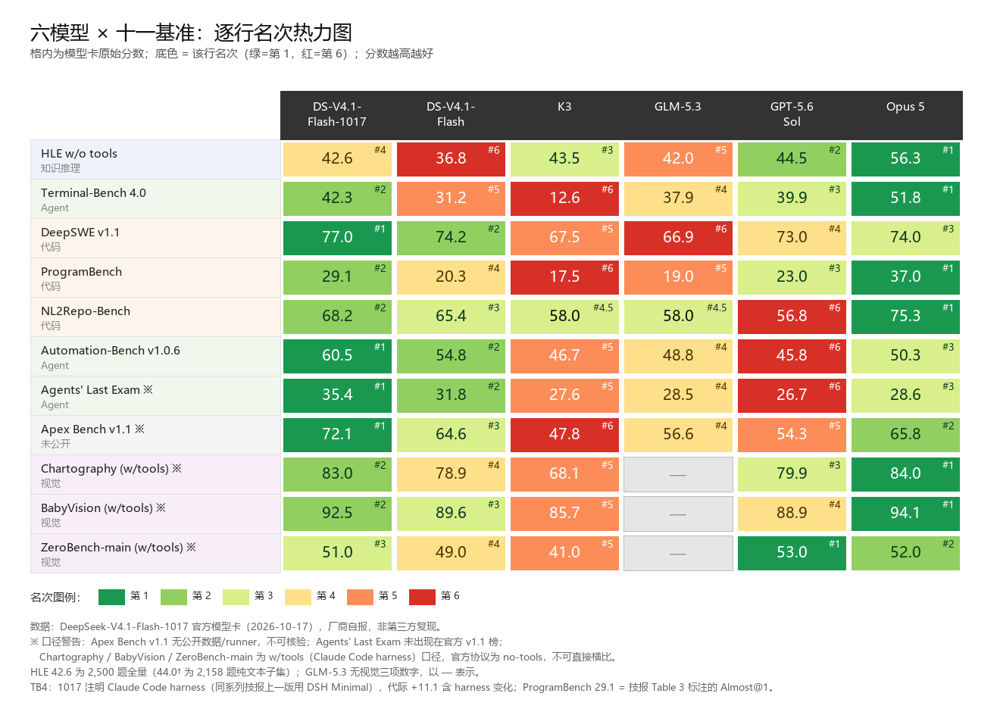

# 六模型 × 十一基准：测试集分析与分数解读

> 分析日期：2026-11-01 ｜ 分析对象：DeepSeek-V4.1-Flash-1017 模型卡对比表（6 模型 × 11 基准）
> 证据基线：本仓库 `research/`（2026-10-30 核实）+ 本轮在线复核（HF 模型卡、DeepSeek 发布新闻表图、DeepSeek-V4.1 技术报告 PDF、Epoch AI / Chartography / AutomationBench / ZeroBench 官方页）
> 过程材料：逐项设计效度长文、可复现的定量脚本、证据审计记录保存在工作区 `.analysis/`（未纳入本仓库）；本报告只保留结论与可核对来源。

**一句话结论**：这 11 个测试集里，协议与数据相对可核对的有 7 行（其中 ALE 仅部分可复现；另有 1 行不可核验、3 行为 w/tools 口径）；DS-V4.1-Flash-1017 的强项集中在 Agent 与代码执行（DeepSWE、Terminal-Bench、Automation），整体名次仍略落后于 Opus 5，但在「协议公开口径」的 7 行上与 Opus 5 并列；HLE 是它唯一低于同场平均的基准，也是与第一梯队差距最大的一项（−13.7 pp）。

---

## 0. 结论速览

1. **组合结构偏工程**：11 项 = 知识推理 1（HLE）+ 代码/终端 4（TB4、DeepSWE、ProgramBench、NL2Repo）+ 业务与真机 Agent 2（Automation、ALE）+ 视觉 3（Chartography、BabyVision、ZeroBench）+ 未公开 1（Apex）。6 项需要工具/环境交互，视觉 3 项是静态图。
2. **全部是厂商自报**：11 行数字来自模型卡，不是第三方复现。唯一有第三方系统性复核记录的是 Terminal-Bench 4.0（Epoch AI 2026-09：30/66 题评分缺陷，评级 Flawed）。
3. **口径问题是系统性的**：同一张表同时混用 w/tools 与 no-tools、公开集与私有 held-out、全量集与纯文本子集、不同指标定义、不同 harness、不同版本。逐行引用前必须先固定六件事。
4. **不可核验 ≠ 不可比**：Apex Bench v1.1 查无主页/论文/数据/runner（唯一来源是 DeepSeek 厂商自报：模型卡 + 发布新闻表图），不应进入任何能力结论（只在含 Apex 的敏感性口径中展示并标注不可核验）；视觉三项是 w/tools 口径，与官方 no-tools 协议不可横比——Chartography 模型卡 83.0 与官方 no-tools 榜同系列 11.6% 是最刺眼的对照。
5. **本轮新增的一手证据（V4.1 技术报告 Table 3）**：模型卡 11 行中**除 Apex 外的 10 行 × 5 个共有模型列**（K3、GLM-5.3、GPT-5.6 Sol、Opus 5、DS-V4.1-Flash）与 V4.1 技术报告 Table 3 的对应格**逐格相等**（技报另有 DS-V4-Pro/DS-V4-Flash 两列及 GPQA 等模型卡未收录的行）。据此技报的指标标注可用于解释本表（模型卡未标指标，属推断）：HLE/TB4/Automation/ALE = **Pass@1**、DeepSWE = **Resolved**、ProgramBench = **Almost@1**（不是主指标 Resolved）、NL2Repo = **Score**、Chartography/BabyVision (w/tools) = **Pass@1**、ZeroBench-main (w/tools) = **Pass@5**；ALE 用 **ALE-CLI（86 题子集）**、Automation 用**公开评测集**；Mini-SWE-V2 = mini-swe-agent 的移植版（commit `04d809ceab9d`）。以上均为技报对上一版的标注/设置，1017 沿用属推断。
6. **TB4 的代际提升混入 harness 变化**：技报中上一版用 DeepSeek Harness（DSH）Minimal，模型卡 1017 注明改用 Claude Code harness → 42.3 vs 31.2 的 +11.1 不能全部归因于模型能力（详见 §4.3）。
7. **总体名次取决于口径**（平均名次，越小越好）：全 11 行 Opus 5 **1.73** > DS-1017 **1.91**；剔除 Apex 后 1.70 vs 2.00；协议公开 7 行 **1.86 = 1.86**（并列）；只看视觉 3 行 Opus 1.33 > DS 2.33。**「谁是第一」取决于把哪几行算进来。**
8. **DS-1017 vs 上一代 DS-V4.1-Flash：11/11 行全部提升**，平均 +5.19 pp（中位 +4.10 pp，逐行相对提升平均 +13.51%）。提升最大的是 TB4 +11.1（含 harness 混入）与 ProgramBench +8.8；判分机制最干净的高分提升是 DeepSWE 74.2 → 77.0（第 1，领先 Opus 3.0；仍为厂商自报）。
9. **对竞品**：对 K3 **10 胜 1 负**（唯一负于 HLE −0.9；若 HLE 换成纯文本 † 口径则反超 +0.5），对 GLM-5.3 **8 胜 0 负**，对 GPT-5.6 Sol **9 胜 2 负**（HLE、ZeroBench），对 Opus 5 **4 胜 7 负**（最大落后 HLE −13.7；4 胜中只有 DeepSWE 的判分机制最干净，但仍是厂商自报、harness 为移植版）。
10. **引用规则**：DeepSWE 可以作为「本表内相对最可引用的领先」引用（判分机制干净；仍为厂商自报）；HLE 只能引用「提升」、不能引用「领先」；视觉三项必须写 `w/tools`；TB4 必须同时写 Epoch Flawed 与 harness 疑点；Automation/ALE/Apex 的「第一」分别要带「公开集」「未上官方榜/ALE-CLI」「不可核验」脚注。

---

## 1. 分析对象、方法与证据分级

### 1.1 数据表（逐字转录，66 格已核对）

来源：HF `deepseek-ai/DeepSeek-V4.1-Flash-1017` 模型卡对比表（本地存档 `sources/deepseek-v41-flash-1017-model-card.md`）。66 个分数格与模型卡逐字一致（0 差异），在线 HF 原文与本地存档亦一致（2026-11-01 复核）；DeepSeek 发布新闻页内嵌表图（`v4.1_261017_benchmark_table_en.png`）为第二处厂商来源，数字与脚注一致。

| Benchmark | DS-V4.1-Flash-1017 | DS-V4.1-Flash | K3 | GLM-5.3 | GPT-5.6 Sol | Opus 5 |
| :--- | :---: | :---: | :---: | :---: | :---: | :---: |
| HLE w/o tools | 42.6 (44.0†) | 36.8 (39.1†) | 43.5 | 42.0† | 44.5 | 56.3 |
| Terminal-Bench 4.0 | 42.3 | 31.2 | 12.6 | 37.9 | 39.9 | 51.8 |
| DeepSWE v1.1 | 77.0 | 74.2 | 67.5 | 66.9 | 73.0 | 74.0 |
| ProgramBench | 29.1 | 20.3 | 17.5 | 19.0 | 23.0 | 37.0 |
| NL2Repo-Bench | 68.2 | 65.4 | 58.0 | 58.0 | 56.8 | 75.3 |
| Automation-Bench v1.0.6 | 60.5 | 54.8 | 46.7 | 48.8 | 45.8 | 50.3 |
| Agents' Last Exam | 35.4 | 31.8 | 27.6 | 28.5 | 26.7 | 28.6 |
| Apex Bench v1.1 | 72.1 | 64.6 | 47.8 | 56.6 | 54.3 | 65.8 |
| Chartography (w/tools) | 83.0 | 78.9 | 68.1 | — | 79.9 | 84.0 |
| BabyVision (w/tools) | 92.5 | 89.6 | 85.7 | — | 88.9 | 94.1 |
| ZeroBench-main (w/tools) | 51.0 | 49.0 | 41.0 | — | 53.0 | 52.0 |

模型卡脚注（逐字）：*† denotes the text-only subset of HLE. We use the Claude Code harness for Terminal-Bench 4.0 and the Mini-SWE-V2 harness for DeepSWE v1.1.*

> 说明：GLM-5.3 在视觉三项为「—」，跨模型比较时按缺格处理（不当 0 分）；其平均名次只用 8 个参评行计算，不可与非缺格模型直接比较。

### 1.2 三种「数字性质」，不要混用

| 性质 | 含义 | 本表中的体现 |
| :-- | :-- | :-- |
| **厂商自报** | 发布方自己给出、未附完整可复现配置，或未进入基准官方榜 | 11 行全部属于此类（模型卡）；Apex Bench v1.1 只有这一类来源 |
| **第三方复核** | 独立第三方按官方协议复跑或审计 | 仅 TB4 有系统性复核（Epoch AI：30/66 题缺陷、Flawed）；其余 10 项未见针对 DeepSeek 数字的第三方复核 |
| **官方榜** | 基准方自己的排行榜/协议/私有 held-out 集 | HLE、Automation、ALE、Chartography、BabyVision、ZeroBench 等有官方榜，但本表数字**多数不是**官方榜值（见 §4） |

### 1.3 本轮新增的一手证据与其边界

- **DeepSeek-V4.1 技术报告（51 页，PDF）**：Table 3（p.33）中，模型卡除 Apex 外的 10 个基准行 × 5 个共有模型列与模型卡**逐格相同**（技报另有 DS-V4-Pro/DS-V4-Flash 列及 GPQA 等模型卡未收录行），并给出指标名（见 §4.3）；p.32 给出各 harness 设置；p.48 脚注说明 mini-SWE 用的移植版本。该报告的评测对象是 **DeepSeek-V4.1-Flash（上一版）**，1017 是其 minor update，模型卡新增了 1017 列。
- **可以成立的推断**：模型卡新增列沿用同一套 benchmark 定义与指标（表结构、竞品数字、脚注均延续）。
- **不能成立的推断**：不能据此断言 1017 的每次运行配置（采样数、judge 版本、harness 版本）与技报完全一致；也不能把竞品数字当成 DeepSeek 独立复跑的结果——它们同时出现在两份 DeepSeek 文档里，来源仍不明。
- 技报 Table 3 的列标题带 **Max**（推理强度 Max）；模型卡未注明 1017 的数字是否为 Max effort，推断同为 Max，但这是推断。

---

## 2. 这套测试集在测什么

### 2.1 类别与设计意图

| 类别 | 基准 | 数量 | 共同特征 |
| :-- | :-- | :-: | :-- |
| 知识推理（闭卷） | HLE | 1 | 唯一不带工具、考知识与深度推理的通识基准；题目跨上百学科 |
| 代码 / 终端 | Terminal-Bench 4.0、DeepSWE v1.1、ProgramBench、NL2Repo-Bench | 4 | 都在容器里「动手做」：终端任务、真实仓库修复、二进制重建、从规格生成整仓 |
| 业务 / 真机 Agent | Automation-Bench、Agents' Last Exam | 2 | 长程多步：REST API 业务编排（无 GUI）、真机 CLI+GUI 专业软件 |
| 视觉 | Chartography、BabyVision、ZeroBench-main | 3 | 静态图理解：专业图表、核心视觉感知、高难看图推理 |
| 未公开 | Apex Bench v1.1 | 1 | 无任何公开信息，无法归类（第三方猜测为 Multimodal Agent，未经官方证实） |

设计意图很清楚：**用「agentic + coding」证明模型能干活，用「视觉三项」证明多模态，用 HLE 保留一个通识知识锚点，再加一个内部基准 Apex**。这不是一套能力均衡的通用评测组合，而是一套围绕 DeepSeek-V4.1-Flash-1017 卖点选的展示型组合。

### 2.2 覆盖矩阵（简化）

| 基准 | 闭卷知识 | 多步推理 | 代码修改 | 从零建仓 | 终端/CLI | API 业务 | GUI/真机 | 专业图表 | 核心视觉 | 长程（小时级） |
| :-- | :-: | :-: | :-: | :-: | :-: | :-: | :-: | :-: | :-: | :-: |
| HLE | ● | ● | ○ | ○ | ○ | ○ | ○ | ○ | ◐ | ○ |
| Terminal-Bench 4.0 | ◐ | ● | ● | ◐ | ● | ○ | ○ | ○ | ○ | ◐ |
| DeepSWE v1.1 | ◐ | ● | ● | ◐ | ● | ○ | ○ | ○ | ○ | ● |
| ProgramBench | ◐ | ● | ◐ | ● | ● | ○ | ○ | ○ | ○ | ● |
| NL2Repo-Bench | ◐ | ● | ◐ | ● | ◐ | ○ | ○ | ○ | ○ | ● |
| Automation-Bench | ○ | ● | ○ | ○ | ○ | ● | ○ | ○ | ○ | ● |
| Agents' Last Exam | ◐ | ● | ◐ | ◐ | ● | ○ | ● | ○ | ◐ | ● |
| Apex Bench v1.1 | ? | ? | ? | ? | ? | ? | ? | ? | ? | ? |
| Chartography | ◐ | ◐ | ○ | ○ | ○ | ○ | ○ | ● | ◐ | ○ |
| BabyVision | ○ | ◐ | ○ | ○ | ○ | ○ | ○ | ○ | ● | ○ |
| ZeroBench-main | ◐ | ● | ○ | ○ | ○ | ○ | ○ | ○ | ● | ○ |

图例：● 直接测；◐ 部分/间接；○ 不测；? 未知。

### 2.3 覆盖盲区（与本次结论直接相关的 6 条）

1. **没有纯数学/形式推理专项**：HLE 是知识+推理混合，不能替代竞赛数学/证明类基准；技报里另有 Codeforces/MathArena Apex，但**没有出现在这张表里**。
2. **没有长上下文专项**：11 项在调研中 `min_context_tokens` 全为 unknown；而模型卡/技术报告强调 1M 上下文、w/tools 用 512k——这项能力在这张表里没有对应证据。
3. **没有多语言/跨语言**：全部基准以英文任务为主，无跨语言一致性设计。
4. **没有安全/对齐/幻觉/校准**：HLE 附带的 RMS calibration error 只是一个副指标；无 safety/red-teaming 基准。
5. **没有视频/音频**：三项视觉基准均为静态图（单图/多图），无视频、语音评测。
6. **没有成本/延迟/能效列**：模型卡正文宣称「更快、更省」，但这张表只有能力分数，没有时间/成本/吞吐列；成本证据只在另两张图或 harness 日志里。

---

## 3. 逐项速览（测什么、怎么判、坑在哪）

> 可信度 = 「模型卡这一行数字作为公开可引用证据」的等级（高/中/低-中/低），不是模型能力高低。

| # | 基准 | 测什么 | 判分 / 指标 | 题量 · 数据 | 该行的关键口径问题 | 可信度 |
| :-: | :-- | :-- | :-- | :-- | :-- | :-: |
| 1 | HLE | 百余学科专家级闭卷问答，考知识与深度推理 | LLM judge（默认 o3-mini），Accuracy | 2,500 题（含 342 带图；纯文本 2,158）；HF gated=auto，MIT | 42.6=全量；44.0†=纯文本子集；同表 K3/GPT/Opus 未标 †；官方另有私有 held-out | **高** |
| 2 | Terminal-Bench 4.0 | 容器终端里完成真实工程任务 | 容器 verifier；官方榜 k=5 平均，技报标为 Pass@1（模型卡未注明，推断同口径） | 66 题，v4.0.0；Apache-2.0 | 模型卡用 Claude Code harness（技报上一版用 DSH Minimal）→ 代际对比混 harness；Epoch Flawed 30/66 | **中** |
| 3 | DeepSWE v1.1 | 真实开源仓库的原创长程改码 | 行为 verifier，Pass@1（Resolved） | 113 题 / 91 仓库 / 5 语言；题目公开、HF 轨迹 gated | Mini-SWE-V2 = mini-swe-agent 移植版；官方榜 Pier + mini-swe-agent，非同一封装 | **高** |
| 4 | ProgramBench | 只给二进制+文档，从零重建整个程序 | 隐藏行为测试；官方主指标 Resolved，**技报标为 Almost@1**（推断同口径） | 200 题；HF 测试集 MIT；镜像 linux/amd64 | 29.1 ≠ Resolved（官方榜 Resolved 最高 18.5%）；Almost@1 = ≥95% 测试通过的 rollout 比例 | **中** |
| 5 | NL2Repo-Bench | 自然语言规格 → 完整可安装 Python 库 | 上游 pytest 平均通过率（Score） | 104 题 / 9 类；公开但**无 LICENSE** | 模型卡未说明 harness；论文最强 agent 40.2（不同代/不同 harness），与 68.2 不可对齐；无官方榜 | **中** |
| 6 | Automation-Bench v1.0.6 | 模拟 SaaS 里跨应用完成业务流程 | end-state 程序化断言，strict pass（无 LLM judge） | 公开 600 题（+200 simple）；MIT | 官方榜用**私有 held-out**；技报（对上一版）确认用「公开评测集」→ 60.5 不是官方榜成绩（1017 沿用该口径为推断） | **高**（非官方榜口径） |
| 7 | Agents' Last Exam | 真机 CLI+GUI 的长程职业任务 | 隐藏 reference 确定性判分，passRate/avgScore | 公开 122 active；完整数据 gated=manual（≈39 GB） | 官方 v1.1 榜无 DeepSeek 行；技报用 **ALE-CLI（86 题）** → 35.4 很可能是子集自报 | **低-中** |
| 8 | Apex Bench v1.1 | unknown | unknown | unknown | 无主页/论文/数据/runner/榜单；仅 DeepSeek 厂商自报（模型卡+新闻表图）；技报里也没有这一项 | **低** |
| 9 | Chartography | 专业图表阅读（等值线、K 线、Bode 图…） | LLM judge（gemini-3.5-flash），mean pass@1；官方 10 epochs | 100 题 / 12 领域；HF 数据当前 401，拿不到 | 官方协议 no-tools；模型卡 83.0 是 w/tools（Claude Code harness）；官方 no-tools 榜同系列仅 11.6% | **低** |
| 10 | BabyVision | 婴儿级核心视觉推理（辨别/追踪/空间/模式） | LLM judge，Avg@3（官方 no-tools）；模型卡 w/tools 报 Pass@1 | 388 题 / 22 子类；HF/GitHub MIT 公开 | w/tools 与官方 no-tools + Avg@3 不同口径；judge 敏感（论文 Qwen3-Max、代码默认 gpt-5.2） | **中** |
| 11 | ZeroBench-main | 对抗式高难多步看图推理 | 精确匹配（无 judge）；Pass@1/@5/^5；官方主榜 no-tools（仓库记录） | 100 main + 334 子题；HF gated=auto，MIT | 模型卡 51.0 是 w/tools + 5 samplings；官方 externals 表有标注；官方主榜 no-tools | **中** |

---

## 4. 可信度分级与六类口径陷阱

### 4.1 可信度分级（评的是「这一行数字能否被公开引用」，不是模型强弱）

| 等级 | 基准 | 理由 |
| :-- | :-- | :-- |
| **高** | HLE、DeepSWE、Automation（非官方榜口径） | 协议/数据/判分公开且干净；但 HLE 要带 † 与 held-out，DeepSWE 要带 harness 版本，Automation 要带「公开集」 |
| **中** | TB4、ProgramBench、NL2Repo、BabyVision、ZeroBench-main | 判分可执行但各有问题：TB4 有第三方复核缺陷 + harness 疑点；ProgramBench 指标口径异常；NL2Repo harness 未说明；视觉两项 w/tools 与官方 no-tools 不同口径 |
| **低-中** | Agents' Last Exam | 协议公开但 35.4 未上官方榜、很可能是 ALE-CLI 子集 |
| **低** | Apex Bench v1.1、Chartography | Apex 不可核验；Chartography w/tools 与官方 no-tools 差距悬殊且数据 401 |

### 4.2 六类口径陷阱（逐项引用前必须确认）

| # | 陷阱 | 受影响基准 | 后果 | 处理规则 |
| :-: | :-- | :-- | :-- | :-- |
| 1 | **w/tools vs no-tools** | Chartography、BabyVision、ZeroBench-main | 官方脚本跑不出 w/tools 分；Chartography 83.0 vs 官方 no-tools 11.6% 说明两者不是同一把尺；不能解读为「工具增益」 | 引用必写 `w/tools` + Claude Code harness + 采样；自测只跑官方 no-tools 协议 |
| 2 | **公开集 vs 私有 held-out** | Automation、HLE、ALE | 本地分数永远对不上官方榜；ALE 完整数据 gated=manual（39 GB） | 先问官方榜跑哪套集；报告写清 dataset 版本与是否 held-out |
| 3 | **全量 vs 纯文本子集（†）** | HLE | 42.6 < K3 43.5，但 44.0† > GLM-5.3 42.0†——**排名会翻转**；把 44.0† 当全量会高估 | 每处引用写题量与 †；跨模型比较确认对方同子集 |
| 4 | **指标定义不同** | ProgramBench、NL2Repo、ALE、Automation、TB4 | ProgramBench 的 29.1 技报标为 Almost@1，不是 Resolved（18.5% 上限）；TB4 官方榜 k=5 而模型卡行技报标为 Pass@1（以上两处为技报标注、推断同口径）；ALE 的 passRate/avgScore 为官方榜定义，模型卡未注明本表用哪个 | 引用写指标全称与定义（含采样/rollout 规则） |
| 5 | **harness / scaffold 不同** | TB4、DeepSWE、NL2Repo、视觉三项、ALE、Automation | 模型能力与 scaffold 能力不可分离；同一模型换 harness 分数可显著变化（技报 Table 4：DeepSWE 上 Claude Code 69.8 vs mini-SWE 74.2） | 报告写 harness + agent + judge 版本；跨来源比较必须同 harness |
| 6 | **版本漂移** | 全部（尤其 TB4、ProgramBench、ZeroBench、Automation） | 连续基准删/改题会直接改变难度与分数 | 锁 `@4.0.0`、`1.0.6`、v1.1、数据 revision、judge 版本，并给出核实日期 |

### 4.3 技报补充的三处重要修正（本轮新增；均据技报推断，模型卡未注明）

1. **ProgramBench 29.1 = Almost@1（据技报推断）**：技报 p.33 Table 3 把该列标为 `ProgramBench (Almost@1)`，且竞品列（37.0/23.0/17.5/19.0）与模型卡逐格相同。Almost@1 的定义见技报 p.36：**单次 rollout 在隐藏测试上得分 ≥0.95 的比例**（官方 ProgramBench 榜列名为 Almost，指 ≥95% 测试通过）。它与官方主指标 Resolved（全测试通过，榜上最高 18.5%）不可比——29.1 并不表示「29.1% 的题被完全重建」，而是「29.1% 的尝试达到 ≥95% 测试通过」。仓库旧表述「大概率是平均测试通过率」应废弃。
2. **ALE 用 ALE-CLI（86 题子集）**：技报 p.32 明确写 General agent 用 “Agents' Last Exam (Sun et al., 2026a) (ALE-CLI)”；ALE-CLI 是 122 题中的 86 题 CLI 子集。且模型卡「上一版」列 31.8 与技报 DS-V4.1-Flash 值一致。因此 35.4 很可能是 ALE-CLI 子集的自报 Pass@1，**不是** 122 题全量，更不是官网宣传的 1,500+ 题。
3. **TB4 的 harness 变化与 Pass@1**：模型卡脚注注明 1017 用 Claude Code harness；技报 p.32 则写上一版 code agent 用「DeepSeek Harness 的 Minimal 模式」（DeepSWE 例外，用 mini-SWE）。两者不一致 → TB4 的 42.3 vs 31.2（+11.1）可能混入 harness 变化，**不能全部归因于模型升级**；同时技报 Table 3 把 TB4 标为 Pass@1，而官方 leaderboard 是 k=5 平均，引用时不能直接与官方榜数值对齐。

> 另外两处澄清：DeepSWE 的 Mini-SWE-V2 已由技报 p.48 脚注定义——mini-swe-v2 是 mini-swe-agent（commit `04d809ceab9d`）的移植版（单 bash 工具 + submission marker），并非完全未知的第三方 harness，但仍与官方榜的 Pier 默认配置不同源；Apex Bench v1.1 **未出现在技报 Table 3**（技报只有 MathArena Apex 65.6），进一步说明它是模型卡/新闻图专属的内部数字。

---

## 5. 六模型分数怎么读（定量）

### 5.1 名次全景

逐行第一名分布：**Opus 5 拿 6 行第一**（HLE、TB4、ProgramBench、NL2Repo、Chartography、BabyVision），**DS-1017 拿 4 行第一**（DeepSWE、Automation、ALE、Apex），**GPT-5.6 Sol 拿 1 行第一**（ZeroBench-main），K3 / GLM-5.3 / DS-V4.1-Flash 无第一。DS-1017 的 4 个第一里：1 个判分机制最干净（DeepSWE）、1 个公开集自跑（Automation）、1 个未上官方榜（ALE）、1 个不可核验（Apex）——这一点决定了 §6 的措辞。

### 5.2 平均名次（三种主口径 + 一个补充口径）

| 模型 | (a) 全部 11 行 | (b) 剔除 Apex（10 行） | (c) 协议公开 7 行 | (d) 全员有值 8 行（7+Apex） | 视觉 3 行 |
| :-- | --: | --: | --: | --: | --: |
| DS-V4.1-Flash-1017 | 1.91 | 2.00 | **1.86** | **1.75** | 2.33 |
| DS-V4.1-Flash | 3.45 | 3.50 | 3.43 | 3.38 | 3.67 |
| K3 | 5.05 | 4.95 | 4.93 | 5.06 | 5.00 |
| GLM-5.3 | 4.56（8 行） | 4.64（7 行） | 4.64 | 4.56 | — |
| GPT-5.6 Sol | 3.91 | 3.80 | 4.29 | 4.38 | 2.67 |
| Opus 5 | **1.73** | **1.70** | **1.86** | 1.88 | **1.33** |

- (c)「协议公开 7 行」= HLE、TB4、DeepSWE、ProgramBench、NL2Repo、Automation、ALE；剔除 Apex（不可核验）与视觉三项（w/tools 不可比）。它是**唯一 6 个模型行数相同、且每行都有公开协议/数据**的口径，但 **7 行全部仍为厂商自报**，其中 3 行另有公开集/未上榜/指标口径疑点（Automation 公开集、ALE 未上榜、ProgramBench 指标异常），**不等于已被第三方复核**。
- 结论：**全 11 行看 Opus 5 第一（1.73 vs 1.91）；(c) 口径两人并列（1.86 = 1.86）；(d) 口径 DS-1017 第一（1.75 vs 1.88）。** 差异来源单一——三项视觉 w/tools 行 Opus 全第 1，Apex 行 DS 第 1、Opus 第 2；两种「边缘行」方向相反，所以「第一」取决于纳入哪些行。报告必须并列呈现，不能只报一个。
- GLM-5.3 只在 8 行参评，其平均名次不可与 11 行模型直接比较；在 (c) 的 7 行里它 4.64，排第 5。

### 5.3 代际提升：DS-1017 vs DS-V4.1-Flash

| 基准 | 上一代 | 1017 | Δ pp | 相对 Δ | 备注 |
| :-- | --: | --: | --: | --: | :-- |
| Terminal-Bench 4.0 | 31.2 | 42.3 | **+11.1** | +35.6% | 含 harness 变化疑点（DSH Minimal → Claude Code） |
| ProgramBench | 20.3 | 29.1 | **+8.8** | +43.3% | 指标为 Almost@1（技报标注；推断同口径） |
| Apex Bench v1.1 | 64.6 | 72.1 | +7.5 | +11.6% | 不可核验 |
| HLE | 36.8 | 42.6 | +5.8 | +15.8% | 纯文本口径：39.1† → 44.0†（+4.9） |
| Automation-Bench | 54.8 | 60.5 | +5.7 | +10.4% | 公开集口径 |
| Chartography (w/tools) | 78.9 | 83.0 | +4.1 | +5.2% | w/tools，不可与官方榜比 |
| Agents' Last Exam | 31.8 | 35.4 | +3.6 | +11.3% | 可能为 ALE-CLI |
| BabyVision (w/tools) | 89.6 | 92.5 | +2.9 | +3.2% | 已接近人类基线 94.1 |
| DeepSWE v1.1 | 74.2 | 77.0 | +2.8 | +3.8% | 判分机制干净，含金量最高 |
| NL2Repo-Bench | 65.4 | 68.2 | +2.8 | +4.3% | harness 未说明 |
| ZeroBench-main (w/tools) | 49.0 | 51.0 | +2.0 | +4.1% | 官方 externals 表旧值 49.0 可对照 |

**平均 +5.19 pp（中位 +4.10），11/11 行提升**。但要打两处折扣：① TB4 的 +11.1 混入 harness 变化；② Apex/视觉/ALE 等行本身不可核验或口径不可比。**相对最可信的提升是 DeepSWE +2.8（判分机制干净、行内竞争最激烈）与 HLE +5.8（协议公开、但只能说明公开集提升）；两者仍属厂商自报。**

### 5.4 对竞品胜负（行级比较，仅统计双方都有分的行）

| 对比 | 胜-平-负 | 说明 |
| :-- | :-- | :-- |
| DS-1017 vs K3 | **10-0-1** | 唯一落后 HLE −0.9；若用 HLE † 口径 44.0 vs 43.5 则反超 +0.5 |
| DS-1017 vs GLM-5.3 | **8-0-0** | 只在 8 行可比（GLM 无视觉三项） |
| DS-1017 vs GPT-5.6 Sol | **9-0-2** | 落后 HLE −1.9、ZeroBench −2.0 |
| DS-1017 vs Opus 5 | **4-0-7** | 胜：DeepSWE +3.0、Automation +10.2、ALE +6.8、Apex +6.3；负：HLE −13.7、TB4 −9.5、ProgramBench −7.9、NL2Repo −7.1、Chart −1.0、BabyVision −1.6、ZeroBench −1.0 |

DS-1017 对 Opus 5 的 4 个胜项里，DeepSWE 是唯一「判分机制干净」的胜项；另外 3 个分别带公开集、未上榜、不可核验的限定。**因此「DS-1017 对 Opus 5 有 4 项领先」这句话是真的，但能当能力证据的只有 DeepSWE 一项（相对最可用，但仍属厂商自报）。**

### 5.5 区分度与基准间一致性

| 基准 | 极差（pp） | 变异系数 | 判读 |
| :-- | --: | --: | :-- |
| Terminal-Bench 4.0 | 39.2 | 33.7% | 最能区分（但部分由 K3 12.6 的离群值拉大） |
| ProgramBench | 19.5 | 27.9% | 区分度较好（指标为 Almost@1） |
| HLE | 19.5 | 13.3% | 区分度中等，Opus 一枝独秀 |
| NL2Repo | 18.5 | 10.6% | 中等 |
| Apex | 24.3 | 13.5% | 不可核验 |
| Automation | 14.7 | 10.0% | 中等 |
| ALE | 8.7 | 10.0% | 压缩（26.7–35.4） |
| Chartography | 15.9 | 7.2% | 压缩（仅 5 模型） |
| ZeroBench | 12.0 | 8.8% | 压缩 |
| DeepSWE | 10.1 | 5.1% | 高分压缩（66.9–77.0） |
| BabyVision | 8.4 | 3.2% | 最不能区分（85.7–94.1；头部 92.5/94.1 接近基线 94.1） |

基准间秩相关（n=5–6 模型，仅探索）：Automation 与 ALE 的模型排序完全一致（ρ=+1.00），TB4 与 ProgramBench 高度一致（+0.94）；而 HLE 与 Automation/ALE 负相关（−0.43）——**「知识强」与「业务 Agent 强」在这 6 个模型上不是同一维度**。协议公开 7 行内部 21 对平均 ρ=+0.46（全 11 行 55 对为 +0.53）——这套基准不是一个单因子，不能用「平均名次」假装它是。

### 5.6 饱和 / 难度分层

- **接近饱和（在本表模型集合内）**：BabyVision w/tools（Opus 94.1 = 人类基线 94.1）、DeepSWE（66.9–77.0）、Chartography w/tools（78.9–84.0）。这些行对前沿模型的区分力会快速下降。
- **远未饱和**：TB4（最高 51.8）、ProgramBench Almost@1（最高 37.0）、ALE（最高 35.4）、HLE（最高 56.3）、ZeroBench Pass@5（最高 53.0）。这些是「还能拉开差距」的测试集。
- **注意**：上述「饱和」是按本表口径说的；换成官方 no-tools 协议（尤其视觉三项），数字会显著下降（Chartography 同系列 11.6%），不能用 w/tools 的 83–94 判断基准饱和。

---

## 6. DS-V4.1-Flash-1017 的位置：哪些结论站得住

### 6.1 站得住的结论

1. **DeepSWE v1.1 = 77.0 是本表内相对最可引用的领先**：超过上一代 74.2、Opus 74.0、GPT-5.6 Sol 73.0，判分是行为 verifier（binary reward），任务公开；harness 是 mini-swe-agent 的移植版（技报已给出 commit），与官方榜配置接近但不完全同一封装。这是全表里**少数可以在带脚注前提下说「第一」的一行**（仍为厂商自报）。
2. **相对上一代全面进步（11/11 行）**，平均 +5.19 pp；进步较大的行是 TB4/ProgramBench（+Apex，但不可核验），另有 HLE +5.8；Automation +5.7，与模型卡「强化 agentic 能力」的叙事一致。
3. **在业务 Agent（Automation 60.5）与长程真机 Agent（ALE 35.4）上表内第一**，但两者分别是「公开集自跑」与「未上官方榜/ALE-CLI 子集」，只能作为方向性证据。
4. **视觉三项与 Opus 5 的差距很小**（Chart −1.0、BabyVision −1.6、ZeroBench −1.0），但都是 w/tools 口径；官方 no-tools 协议下的真实差距未知，不能用这组数字外推。
5. **对 K3、GLM-5.3、GPT-5.6 Sol 总体占优**（10-1、8-0、9-2；对 GPT-5.6 Sol 在 HLE、ZeroBench 两行落后），说明在这套组合的口径下，DS-1017 至少是「第二梯队前列」。

### 6.2 明显短板

1. **HLE 是最大短板**：42.6 比 Opus 5 低 13.7 pp（44.0† 与 Opus 56.3 相比低 12.3，但 Opus 无 † 值，此对比仍属跨口径，仅作量级参考），也低于 GPT-5.6 Sol 1.9、K3 0.9（全量口径）；HLE 是 11 行中 DS-1017 唯一低于同场平均的基准（行内 z≈−0.29）。若关心知识与深度推理，这是最需要补的项。
2. **ProgramBench / NL2Repo 落后 Opus 约 7–8 pp**：分别是「从零重建程序」和「从零建仓」两类长程结构化生成，说明与最强闭源模型在「从零造大东西」上仍有差距。
3. **TB4 名义第 2（42.3），但落后 Opus 9.5 pp**，且这一行的 42.3 本身混有 harness 变化与第三方复核缺陷（Epoch Flawed），口径不确定性很大。
4. **没有能全面支撑「超越 Opus」的证据**：4 个胜项里 3 个带不可核验/口径限定，只有 DeepSWE 相对干净（仍为厂商自报）。

### 6.3 不能声称的

- 不能说「DS-1017 综合第一」——全 11 行平均名次仍落后 Opus 5（1.91 vs 1.73）。
- 不能说「图表理解 83.0 接近 Opus 84.0」——w/tools 口径且 Chartography 数据当前不可得，官方 no-tools 下同系列仅 11.6%。
- 不能说「Apex Bench 72.1 领先」——无任何公开信息可核验。
- 不能说「ALE 35.4 是 122 题全量成绩」——技报口径为 ALE-CLI（86 题），模型卡未注明。
- 不能说「TB4 +11.1 全是模型进步」——harness 从 DSH Minimal 换到 Claude Code 的疑点未澄清。
- 不能把 Automation 60.5 与官方榜（私有 held-out）并排——技报（对上一版）确认用的是公开评测集，1017 沿用该口径为推断。

### 6.4 与上一代相比的一句话评价

**这是一次「agentic 能力优先」的小版本升级**：相对可核实的提升集中在 DeepSWE（+2.8）、HLE（+5.8，公开集；两者仍为厂商自报）；TB4/ProgramBench 的「大提升」（+11.1/+8.8）分别被 harness 疑点与指标口径稀释；视觉三项 +2.0～+4.1，但都在 w/tools 口径内（BabyVision 已接近人类基线 94.1）。整体是「更强的 Agent 模型」，但**在知识与从零建仓两项上仍明显落后 Opus 5**。

---

## 7. 使用建议

### 7.1 引用三档

| 用途 | 可用的行 | 必须加的条件 |
| :-- | :-- | :-- |
| **相对最可引用（仍为厂商自报）** | DeepSWE 77.0 | 厂商自报 + Mini-SWE-V2（mini-swe-agent 移植）+ Pass@1/Resolved + v1.1 |
| **可引用但必须加脚注** | HLE 42.6 / 44.0†；TB4 42.3；ProgramBench 29.1；NL2Repo 68.2；Automation 60.5；ALE 35.4；BabyVision 92.5；ZeroBench 51.0 | HLE：2,500 题/2,158†、no-tools、LLM judge、held-out；TB4：Claude Code harness、Epoch Flawed、Pass@1；ProgramBench：Almost@1 不是 Resolved；NL2Repo：harness 未说明；Automation：公开集；ALE：未上官方榜、疑似 ALE-CLI；BabyVision：w/tools + Pass@1 vs 官方 no-tools Avg@3；ZeroBench：w/tools + 5 samplings |
| **不可作为能力证据** | Apex 72.1；Chartography 83.0（作为「与 Opus 比较」时） | Apex：仅厂商自报、不可核验、不进入能力结论（仅在敏感性口径展示）；Chartography：w/tools 与官方 no-tools 不可比、数据 401 |

### 7.2 想自己复核时的优先级（性价比）

1. **DeepSWE 10 题抽样**（官方 `--n-tasks 10 --sample-seed 0`）：验证 77.0 最划算，判分干净、成本可控。
2. **ZeroBench-main**：100 题 × 5 次、无需 judge、精确匹配，可复现官方 no-tools 侧；w/tools 需自搭 Claude Code harness，只能近似，不能与模型卡对齐。
3. **BabyVision**：数据 MIT 公开、脚本完整，约 1–3 小时可跑 388 题 × Avg@3（估算，未实测）。
4. **HLE 纯文本 50 题**：验证 42.6/44.0† 的相对位置；注意 judge 版本。
5. **Automation-Bench 公开集 20–50 题**：验证 60.5 是否为公开集口径（预期接近）。
6. **不建议**：Chartography（数据 401）、Apex（无数据）、ALE 全量（39 GB + 真机）、NL2Repo 全量（无 license、数百轮）。

### 7.3 如果要做对外横评

- 固定「同一模型 + 同一 harness + 同一数据版本 + 同一 judge + 同采样」五要素，否则不要跨来源比。
- 优先选择判分可执行的基准（DeepSWE、ZeroBench、Automation、ProgramBench、TB4），少用 LLM judge 且必须固定 judge 版本。
- 报告里同时给「全 11 行」「剔除不可核验」「剔除 w/tools」三套口径，并明确「第一」的判定依赖口径。

---

## 附录 A：完整分数与名次（含口径标记）

见 §1.1 表；名次矩阵如下（1=最好）：

| 基准 | DS-1017 | DS-V4.1-Flash | K3 | GLM-5.3 | GPT-5.6 Sol | Opus 5 |
| :-- | :-: | :-: | :-: | :-: | :-: | :-: |
| HLE | 4 | 6 | 3 | 5 | 2 | 1 |
| TB4 | 2 | 5 | 6 | 4 | 3 | 1 |
| DeepSWE | 1 | 2 | 5 | 6 | 4 | 3 |
| ProgramBench | 2 | 4 | 6 | 5 | 3 | 1 |
| NL2Repo | 2 | 3 | 4.5 | 4.5 | 6 | 1 |
| Automation | 1 | 2 | 5 | 4 | 6 | 3 |
| ALE | 1 | 2 | 5 | 4 | 6 | 3 |
| Apex | 1 | 3 | 6 | 4 | 5 | 2 |
| Chartography | 2 | 4 | 5 | — | 3 | 1 |
| BabyVision | 2 | 3 | 5 | — | 4 | 1 |
| ZeroBench | 3 | 4 | 5 | — | 1 | 2 |

## 附录 B：来源与证据锚点

- **本表 66 格**：`sources/deepseek-v41-flash-1017-model-card.md:49-65`；在线原文 <https://huggingface.co/deepseek-ai/DeepSeek-V4.1-Flash-1017/raw/main/README.md>；发布新闻页 <https://api-docs.deepseek.com/news/news261017>（内嵌表图 `https://api-docs.deepseek.com/img/v4.1_261017_benchmark_table_en.png`）（均 2026-11-01 复核一致）。
- **技术报告 Table 3 / p.32 / p.48**：<https://huggingface.co/deepseek-ai/DeepSeek-V4.1-Flash/resolve/main/DeepSeek_V41_Tech_Report.pdf>（51 页；本轮下载并抽取核对）。
- **TB4 第三方复核**：<https://epoch.ai/benchmarks/terminal-bench-4/review>（2026-09-04，30/66 缺陷、Flawed）；v4.0.0 release 2026-08-26。
- **HLE**：<https://lastexam.ai>、<https://arxiv.org/abs/2501.14249>、<https://github.com/centerforaisafety/hle>、<https://huggingface.co/datasets/cais/hle>、<https://ukgovernmentbeis.github.io/inspect_evals/evals/hle/index.html>（342/2,500、2,158 文本）。
- **DeepSWE**：<https://deepswe.datacurve.ai/>、<https://deepswe.datacurve.ai/blog/deepswe-v1-1>（113 题）、<https://github.com/datacurve-ai/deep-swe>、<https://arxiv.org/abs/2607.07946>。
- **ProgramBench**：<https://programbench.com/>（200 题、Resolved 18.5%）、<https://huggingface.co/datasets/programbench/ProgramBench-Tests>、<https://github.com/facebookresearch/ProgramBench>。
- **NL2Repo-Bench**：<https://github.com/multimodal-art-projection/NL2RepoBench>、<https://arxiv.org/abs/2512.12730>。
- **Automation-Bench**：<https://github.com/zapier/AutomationBench>（600 公开 + simple 200、官方私有 held-out）、<https://zapier.com/benchmarks>、<https://arxiv.org/abs/2604.18934>。
- **Agents' Last Exam**：<https://agents-last-exam.org>、<https://github.com/rdi-berkeley/agents-last-exam>、<https://arxiv.org/abs/2606.05405>、<https://agents-last-exam.org/api/demo/leaderboard/v1.1>（22 行/12 模型、无 DeepSeek）。
- **Apex Bench v1.1**：仅模型卡与发布新闻表图；第三方转引 <https://phaseo.app/zh-Hans/benchmarks/apex-bench-v1.1>（注明 ≠ MathArena Apex、≠ APEX-Agents）。
- **Chartography**：<https://surgehq.ai/benchmarks/chartography>（官方 no-tools 榜、同系列 11.6%）、<https://arxiv.org/abs/2608.10677>、<https://github.com/surge-ai/chartography>；HF 数据集 401。
- **BabyVision**：<https://huggingface.co/datasets/UnipatAI/BabyVision>（MIT、388）、<https://github.com/UniPat-AI/BabyVision>、<https://arxiv.org/abs/2601.06521>。
- **ZeroBench**：<https://zerobench.github.io>（externals 表）、<https://github.com/jonathan-roberts1/zerobench>、<https://huggingface.co/datasets/jonathan-roberts1/zerobench>、<https://arxiv.org/abs/2502.09696>。
- 逐条证据定位（文件:行号 + 在线 URL）见 `.analysis/verify/verification.md`。

## 附录 C：局限与待核实

1. **TB4 harness 变更**：技报（上一版）DSH Minimal 与模型卡（1017）Claude Code 不一致，官方未解释；代际 +11.1 的解释需谨慎。
2. **竞品数字来源不明**：同一组数字同时出现在模型卡与技报，未注明是官方榜转录还是 DeepSeek 自跑，因此「DS vs 竞品」本质是「同一文档内的数字对比」。
3. **ALE-CLI 推断**：技报对上一版明确用 ALE-CLI，模型卡未注明 1017 是否同为 ALE-CLI；35.4 的题集口径是推断。
4. **Apex Bench v1.1**：仍只有厂商自报，无法核验；本报告不将其纳入任何能力结论（仅作 (a)(d) 敏感性口径展示并标注不可核验）。
5. **ZeroBench 官方主榜 no-tools**：仓库记录一致，但本轮未在官网找到明确文字（官方 externals 表可查 w/tools 标注）。
6. **Chartography 数据许可/可得性**：HF 当前 401，许可 unknown；官方榜 11.6% 与 w/tools 83.0 的差距机制（题面/工具/judge/采样）无法逐项拆分。
7. **统计口径**：本报告所有定量比较均为描述性；6 个模型、11 行的样本量不支持显著性推断，「平均名次」只是排序工具，不是能力度量。
